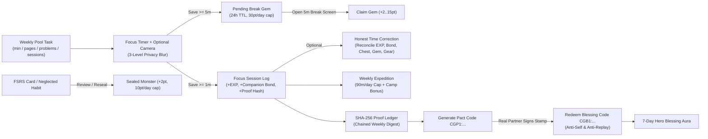

# Craft Glass Architecture (`com.craftglass.app`)

Craft Glass is a **local-first, zero-cost, bilingual (EN/JA)** study & habit RPG built for the AI era:
- **Proof of Human Craft**: Optional blurred desk camera timelapses + SHA-256 hash-chained Proof Ledger + 1080px Weekly Proof Card PNG.
- **Human Blessing Economy**: No AI hype-bot coach. Real partners verify a Proof Pact (`CGP1:...`) and return a cryptographically bound Blessing (`CGB1:...`) that lights a 7-day aura on the hero.
- **Anti-Burnout Weekly Pool**: Total weekly targets (never mixing units) with soft weekday pins, auto-chunks, and a 90-minute/day cap on Weekly Expedition progress.
- **400-Hour Living Pixel Chronicle**: 25 Guild Ranks (Lv.1–Lv.99), 20 Pixel Worlds, 12 Companions with 5-tier Bonding, Break Gems (claimable only during breaks), Sealed Monsters (FSRS flashcards + neglected habits), and Honest Time Correction with anti-cheese point reconciliation.

## State Transitions & Proof Flow

## Directory Structure

- `web/` — Zero-dependency ES module PWA / SPA (shared cleanly between GitHub Pages demo and Android WebView `https://appassets.craftglass.local/`).
  - `web/src/core/` — Pure domain logic runnable in both Browser & Node 22 (`node --test`).
  - `web/src/ui/` — Canvas pixel renderer, IndexedDB blurred camera timelapse, 1080px Proof Card PNG generator, CC0/WebAudio engine, native Android bridge.
- `android/` — Minimal dependency-free native Android WebView wrapper targeting SDK 35 (`minSdkVersion 26`), edge-to-edge insets, `ShareFileProvider`, `MediaStore.Downloads` export, and runtime Camera permission handling.
- `docs/` — Architecture docs, Privacy Policy (`privacy.html`), Landing & live preview (`docs/app/`).
- `tools/` — Node build/sync/serve/graphics scripts (`sync-assets.mjs`, `serve.mjs`, `generate-store-graphics.mjs`, `build-android.mjs`).
- `.local/` — Gitignored local secrets & outputs (upload keystore, `bundletool.jar`, intermediate build artifacts, release `.aab`).
